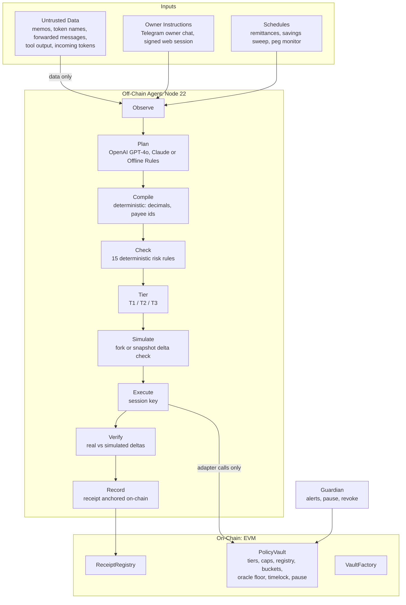

<p align="center">
  <picture>
    <source media="(prefers-color-scheme: dark)" srcset="assets/covenant-logo-dark.svg">
    
  </picture>
</p>

<p align="center">
  <strong>An agent that acts. A contract that answers.</strong><br>
  <em>A guarded family wallet for migrant workers and overseas families.</em>
</p>

<p align="center">
  <strong>PBCSF Fintechathon 2026 · International Track · Topic F — Agent Wallet</strong>
</p>

<p align="center">
  
  
  
  
  
</p>

---

## Key Documents & Deliverables

| Deliverable | Location | Description |
| :--- | :--- | :--- |
| **2-Page Judge Brief** | [docs/judge-brief.md](docs/judge-brief.md) | Executive summary, scenario matrix, security in numbers |
| **Technical Documentation** | [docs/technical.md](docs/technical.md) | System architecture, core algorithms, security design |
| **Security Self-Assessment** | [docs/self-assessment.md](docs/self-assessment.md) | Line-by-line Solidity tier mapping & threat matrix |
| **Known-Risk List** | [docs/known-risks.md](docs/known-risks.md) | 15 identified risks (K-01 to K-15), mitigations & roadmap |
| **Execution Evidence Ledger** | [evidence/localhost/ledger.md](evidence/localhost/ledger.md) | Real on-chain transaction hashes & execution receipts |
| **Red-Team Security Results** | [redteam/RESULTS.localhost.md](redteam/RESULTS.localhost.md) | 30 adversarial attack cases & revert evidence |
| **Deployment Runbook** | [docs/deployment.md](docs/deployment.md) | Step-by-step local and Base Sepolia testnet deployment |
| **Video Walkthrough Plan** | [docs/SCREENRECORDING_WALKTHROUGH_PLAN.md](docs/SCREENRECORDING_WALKTHROUGH_PLAN.md) | Screen recording guide & voiceover script |

---

## Contents

1. [Why Covenant](#1-why-covenant)
2. [What It Does (Topic F Scope)](#2-what-it-does-topic-f-scope)
3. [How It Works](#3-how-it-works)
4. [Permission Tiers](#4-permission-tiers)
5. [Repository Layout](#5-repository-layout)
6. [Quick Start (Local Stack in 2 Minutes)](#6-quick-start-local-stack-in-2-minutes)
7. [AI Model Support](#7-ai-model-support)
8. [Using the Web Dashboard](#8-using-the-web-dashboard)
9. [Demo Scenarios D1–D9](#9-demo-scenarios-d1d9)
10. [Red-Team Security Suite](#10-red-team-security-suite)
11. [Testing & Invariant Verification](#11-testing--invariant-verification)
12. [Verifiable Intent Receipts](#12-verifiable-intent-receipts)
13. [HTTP API Reference](#13-http-api-reference)
14. [Deploying to Base Sepolia](#14-deploying-to-base-sepolia)
15. [Configuration Reference](#15-configuration-reference)
16. [Licence](#16-licence)

---

## 1. Why Covenant

Rahim works abroad and supports his mother and children back home. He needs money remitted on time and savings that grow safely. Two catastrophic failure modes threaten his livelihood:

- **A compromised AI agent:** Prompt injection through a transfer memo, a hallucinated amount, or a stolen agent session key.
- **A human scammer:** Social engineering, fabricated urgency, "a new phone number", or a fraudulent "customs clearance fee" to release an imaginary parcel.

Every conventional agent-wallet demo displays an LLM capable of calling token transfer functions. The institutional question a bank or regulator asks is fundamentally different: **what is the absolute worst this agent can do?**

Covenant's answer is cryptographically and mathematically enforced on-chain:

> **A stolen agent key can only pay your own family.**

The agent session key can invoke only strictly named, parameter-checked functions on the `PolicyVault` smart contract. Payment recipients come exclusively from a payee registry that only the human owner can modify. Swaps and lending send value back to the vault itself. There is no generic call path (`call`, `delegatecall`, or arbitrary approvals). Caps, a 24-hour sliding window, a co-signature ceiling, cooling-off periods for newly added payees, and an oracle price floor are all enforced in immutable Solidity code.

The same rules protect Rahim from external scammers via the **two-way guardrail**:
- New payees must wait 24 hours before any payout can execute, and the first payment to any counterparty requires the owner's explicit signature.
- Urgent scam patterns trigger deterministic heuristics that hold requests and alert the **guardian** (his mother). The guardian can view balances and trigger an emergency pause on the agent, but cannot spend funds.
- Even the owner's own direct withdrawals to unknown addresses must wait out the cooling-off period.

---

## 2. What It Does (Topic F Scope)

Covenant addresses the three mandatory operations of PBCSF Fintechathon Topic F:

| Operation | What Covenant Does | Smart Contract Functions |
| :--- | :--- | :--- |
| **Asset Management** | Segregates income into **Family Remittance**, **Emergency**, and **Savings** buckets per the owner's plain-English mandate; lends idle savings within an exposure cap (50%); swaps stablecoins with an oracle floor. | `allocate`, `reallocate`, `supply`, `withdraw`, `swap` |
| **Transaction Execution** | Scheduled family remittances; payments initiated via natural-language chat (English & Bangla); gasless EIP-712 co-signed approvals for amounts exceeding Tier 1 limits. | `pay`, `propose`, `approve`, `approveWithSig` |
| **Risk Control** | Four-tier permission hierarchy in Solidity; 15 deterministic firewall rules; pre-trade snapshot/fork simulation; post-trade balance delta verification with automatic circuit breaker; stablecoin peg monitor; sanctions denylist. | `PolicyVault.sol`, `agent/src/risk/` |

Supporting features:
- **Web App:** Real-time balance dashboard, approvals queue, payee manager, plain-English mandate editor, guardian circuit breaker, evidence ledger, and interactive receipt verifier.
- **Verifiable Intent Receipts:** Every state-changing transaction commits an on-chain cryptographic anchor (`intentHash`), linking on-chain execution with off-chain intent and simulated state.
- **Unattended Execution:** An autonomous scheduler manages scheduled income splits, bill payments, and savings sweeps without requiring constant human intervention.

---

## 3. How It Works



Each cycle (`agent/src/loop.js`) follows a deterministic 9-step pipeline:

1. **Observe:** Query live token balances, bucket balances, 24-hour sliding window expenditure, payee states, oracle prices, and vault pause status.
2. **Plan:** The AI model produces strict JSON against a Zod schema. `payee` must resolve to an allowed alias; amounts must be exact decimal strings.
3. **Compile:** Convert human aliases into on-chain `bytes32` payee identifiers, resolve token decimals, and format exact calldata.
4. **Check:** Evaluate 15 deterministic risk rules (R-01 through R-15). Rule R-01 enforces capability scoping: incoming payment memos can only ever trigger an `allocate`, regardless of prompt instructions.
5. **Tier:** Classify operation tier mirroring contract invariants. T1 proceeds autonomously, T2 generates an on-chain proposal for owner co-signing, and T3 is rejected.
6. **Simulate:** Execute calldata against a local blockchain fork/snapshot using session-key impersonation. Ensure balance deltas match the expected plan.
7. **Execute:** Submit transaction using the agent's session key. Each transaction embeds the cryptographic `intentHash`.
8. **Verify:** Compare post-execution event logs (`Transfer`) with simulated deltas. Any deviation triggers an immediate vault pause and guardian alert.
9. **Record:** Generate a canonical RFC 8785 receipt and anchor its hash in `ReceiptRegistry.sol`.

---

## 4. Permission Tiers

| Tier | Signer | Capabilities & Limits | Enforcement Mechanism |
| :--- | :--- | :--- | :--- |
| **T0 Observe** | None | Read balances, prices, payment history; quote routes; simulate execution. | Agent runtime (no private key access) |
| **T1 Autonomous** | Agent Session Key | Pay registered, cooled-off payees up to **250 USDC / payment** and **300 USDC / 24 h**; reallocate internal buckets; supply/withdraw savings; swap stablecoins. | `PolicyVault.sol` contract logic |
| **T2 Co-signed** | Agent proposes, Owner approves | Payments above T1 limit up to **1,000 USDC ceiling**; first payment to a new payee; expires after 24 hours. | `PolicyVault.sol` (EIP-712 signature or transaction) |
| **T3 Prohibited** | None | Unregistered recipients; amounts above T2 ceiling; policy modifications by agent; arbitrary contract calls; direct token approvals. | `PolicyVault.sol` reverts (`custom errors`) |
| **Guardian** | Owner or Guardian | Emergency pause of all agent activities; session key revocation. Only owner can unpause. | `PolicyVault.sol` (`pause()`, `revokeAgent()`) |
| **Owner Governance** | Owner | Policy tightening is immediate; policy loosening requires a 48h timelock; adding payees enforces a 24h cooling-off period. | `PolicyVault.sol` timelock & cooling-off |

---

## 5. Repository Layout

```
covenant/
├── assets/                   Brand assets (covenant-cover.jpg [16:9 cover], covenant-logo.svg, covenant-icon.svg)
├── contracts/                Solidity smart contracts + Hardhat suite
│   ├── src/PolicyVault.sol   Core vault: tiers, caps, registry, buckets, timelock, pause
│   ├── src/VaultFactory.sol  Owner-signed vault creation (EIP-1167 minimal proxy clones)
│   ├── src/ReceiptRegistry.sol  On-chain intent receipt anchoring
│   ├── src/interfaces/       IPolicyVault, Chainlink, Aave, and Uniswap interfaces
│   ├── src/mocks/            Labelled testnet mocks, attack tokens, and hostile routers
│   ├── test/unit/            38 unit tests (100% line & branch coverage)
│   ├── test/invariant/       EVM property-based invariant test suite (I-1 … I-6)
│   └── scripts/              deploy.js, export-abi.js
├── shared/                   Shared libraries across agent, server, and web
│   ├── schemas/              Zod schemas for plans, mandates, and receipts
│   ├── abi/                  Exported contract ABIs
│   ├── deployments/          Network deployment artifacts
│   ├── mandates/             Structured family mandate templates
│   ├── canonical.js          RFC 8785 canonical JSON hasher & Merkle generator
│   └── constants.js          Bucket IDs, payee IDs, scam weights, risk constants
├── agent/                    Autonomous Agent Core
│   ├── src/loop.js           The 9-step observe-plan-check-simulate-execute cycle
│   ├── src/planner.js        AI prompt formatting & Zod schema validation
│   ├── src/model/            OpenAI (GPT-4o), Claude, and deterministic offline adapters
│   ├── src/firewall.js       Untrusted data containment & trigger-scoped capabilities
│   ├── src/compile.js        Plan-to-calldata compilation
│   ├── src/risk/             15 deterministic risk rules (R-01 … R-15), scam scoring
│   ├── src/simulate.js       EVM fork / snapshot simulation
│   ├── src/verify.js         Post-trade balance verification & circuit breaker
│   └── src/receipts.js       Verifiable Intent Receipt generation & anchoring
├── server/                   Fastify HTTP backend, SQLite store, indexer, scheduler
├── web/                      React 19 + Vite + Tailwind CSS dashboard
├── redteam/                  30-case adversarial attack test suite
├── evidence/                 Recorded on-chain execution ledgers
└── docs/                     Technical documentation, judge brief, self-assessment
```

---

## 6. Quick Start (Local Stack in 2 Minutes)

### Prerequisites
- **Node.js:** `>= 22.0.0`
- **npm:** `>= 10.0.0`

### 1. Installation
```bash
git clone https://github.com/feedofmri/Covenant.git
cd Covenant
npm install
```

### 2. Launch Local Environment
Open 4 terminal windows:

```bash
# Terminal 1: Start local Hardhat blockchain node
npm run node

# Terminal 2: Deploy contracts and seed initial mock state
npm run deploy:local

# Terminal 3: Start backend API server
npm run server

# Terminal 4: Start frontend web interface
npm run web
```

- **Web Dashboard:** [http://127.0.0.1:5173](http://127.0.0.1:5173)
- **Backend API:** [http://127.0.0.1:8787](http://127.0.0.1:8787) (`/health`)
- **JSON-RPC Node:** `http://127.0.0.1:8545` (Chain ID `31337`)

### 3. Generate Evidence & Run Tests
In a new terminal:

```bash
# Run scenarios D1–D9 end-to-end (generates evidence/localhost/ledger.*)
npm run demo

# Execute 30-case red-team adversarial suite
npm run redteam
```

---

## 7. AI Model Support

Covenant features a swappable model adapter architecture:

- **OpenAI (Configured & Live):** Set `OPENAI_API_KEY=sk-...` in `.env`.
  - Structured Planning: `gpt-4o` with strict JSON schema outputs.
  - Scam & Prompt Injection Classification: `gpt-4o-mini`.
- **Anthropic Claude:** Set `ANTHROPIC_API_KEY=sk-ant-...`.
  - Structured Planning: `claude-opus-5-5`.
  - Classification: `claude-haiku-5-5`.
- **Deterministic Offline Rule Planner:** When API keys are omitted or external providers experience downtime, Covenant falls back to a deterministic rule-based planner. Off-chain safety checks, simulations, and Solidity contract boundaries remain 100% active.

---

## 8. Using the Web Dashboard

### Preconfigured Dev Accounts (Localhost)
| Role | Account | Address | Private Key |
| :--- | :--- | :--- | :--- |
| **Owner (Rahim)** | Account #1 | `0x70997970C51812dc3A010C7d01b50e0d17dc79C8` | `0x59c6995e998f97a5a0044966f0945389dc9e86dae88c7a8412f4603b6b78690d` |
| **Guardian (Mother)** | Account #2 | `0x3C44CdDdB6a900fa2b585dd299e03d12FA4293BC` | `0x5de4111afa1a4b94908f83103eb1f1706367c2e68ca870fc3fb9a804cdab365a` |
| **Agent Session Key** | Account #3 | `0x90F79bf6EB2c4f870365E785982E1f101E93b906` | `0x7c852118294e51e653712a81e05800f419141751be58f605c371e15141b007a6` |

### Key Pages & Capabilities
- **Wallet (`/`):** Real-time balance breakdown across Family, Emergency, and Savings buckets; 24h spending window gauge; pending approvals; conversational natural-language chat interface.
- **Approve (`/approve/:id`):** Review and co-sign Tier 2 proposals using one-click gasless EIP-712 signatures relayed by the backend.
- **Payees (`/payees`):** Inspect registered family payees, active status, and 24-hour cooling-off countdowns.
- **Mandate (`/mandate`):** Compose plain-English budget rules (e.g., *"Save 30% of salary, send 200 USDC to Mother"*), view live diffs, and commit on-chain mandate hashes.
- **Guardian (`/guardian`):** Instant emergency pause button, agent revocation, and security alert inbox.
- **Evidence (`/ledger`):** Searchable, filterable audit log of every on-chain transaction with scenario tags, tier classification, and block receipts.
- **Verify (`/verify`):** Cryptographic receipt inspector. Paste any JSON receipt to verify its integrity against the blockchain. Modifying a single character immediately fails verification.

---

## 9. Demo Scenarios D1–D9

The demo runner (`npm run demo`) executes 9 end-to-end scenarios validating all functional requirements:

| Scenario | Title | Tier | Description & Expected Outcome |
| :--- | :--- | :--- | :--- |
| **D1** | Vault Creation | Setup | Owner deploys `PolicyVault` clone via `VaultFactory` with committed mandate hash. |
| **D2** | Income Allocation & Remittance | T1 | 1,000 USDC wage arrives → split 500 / 200 / 300 → autonomous 200 USDC transfer to Mother. |
| **D3** | Idle Savings Yield Sweep | T1 | Savings above 100 USDC buffer are supplied to lending pool within 50% exposure cap. |
| **D4** | Emergency Expense Escalation | T2 | 400 USDC medical expense exceeds T1 limit → agent proposes → owner co-signs via EIP-712. |
| **D5** | Prompt Injection in Memo | T3 | Attacker embeds injection in memo → Rule R-01 restricts capability → call reverts `T3_UnknownPayee`. |
| **D6** | Generic Call Exploit | T3 | Stolen key attempts arbitrary `execute(bytes)` call → rejected by contract (`T3_NoGenericCalls`). |
| **D7** | Social Engineering Scam | Scam Guard | Fabricated customs fee urgency flagged by heuristic scoring → held, explained, guardian alerted. |
| **D8** | Stolen Key Defense | T3 | Attacker key attempts 5 unauthorized calls (new payee, limit hike, drain) → all 5 revert on-chain. |
| **D9** | Depeg Circuit Breaker | Breaker | Mock oracle drops to 0.96 USD → agent unwinds lending positions → reverts `T3_Depegged`. |

---

## 10. Red-Team Security Suite

Covenant includes a 30-case adversarial attack suite (`npm run redteam`):

- **Stack-Level Attacks:** Tested against a **deliberately hijacked AI planner** forced to obey malicious instructions.
- **Contract-Level Attacks:** Assume the off-chain agent key is completely compromised; sends malicious transactions directly to the contract.

| Category | Cases | Primary Defense | Result |
| :--- | :--- | :--- | :--- |
| **Direct Prompt Injection** | RT-01 … RT-03 | Risk rules R-04, R-08, R-11 | **Blocked Off-Chain** |
| **Indirect Memo Injection** | RT-04 … RT-07 | Rule R-01 capability scoping | **Blocked Off-Chain** |
| **Recipient Substitution** | RT-08 … RT-11 | `T3_UnknownPayee`, `T3_NoGenericCalls` | **Reverted On-Chain** |
| **Cap Splitting & Velocity** | RT-12 … RT-14 | `T2_DailyCapExceeded`, sliding window | **Reverted On-Chain** |
| **Approval Abuse** | RT-15 … RT-16 | Zero approval path in `PolicyVault` | **Blocked by Design** |
| **Decimals & Integer Overflow**| RT-17 … RT-18 | `T3_AboveT2Ceiling`, strict Zod schema | **Reverted On-Chain** |
| **Malicious Token Pairs** | RT-19 … RT-20 | `T3_PairNotAllowed`, `T3_AssetNotAllowed` | **Reverted On-Chain** |
| **Scam Social Engineering** | RT-21 … RT-23 | Heuristic scoring, guardian escalation | **Held & Alerted** |
| **Policy Tampering** | RT-24 … RT-28 | `T3_NotOwner`, 48h timelock | **Reverted On-Chain** |
| **Oracle & Depeg Exploits** | RT-29 … RT-30 | Price floor oracle check (`T3_Depegged`)| **Reverted On-Chain** |

**Evaluation Result: 30 of 30 attacks successfully neutralized. Attacker fund gain: 0.00 USDC.**

---

## 11. Testing & Invariant Verification

```bash
# Run complete test suite across all packages
npm test

# Smart contract unit tests (38 tests, 100% line & branch coverage)
npm run test:contracts

# Extended property-based invariant test run (300 sequences × 60 steps)
INVARIANT_RUNS=300 INVARIANT_STEPS=60 npm run test:contracts

# Smart contract coverage report
npm run coverage

# Agent core tests (32 tests covering planning, firewalls, simulation)
npm -w agent test
```

### Core Invariants Enforced
- **I-1 (Total Value Conservation):** Internal bucket allocations equal total vault token balance.
- **I-2 (Unregistered Payee Invariant):** Zero wei can transfer to any address not verified in the registry.
- **I-3 (Sliding Window Cap):** Outflows over any continuous 24-hour period never exceed the daily limit.
- **I-4 (Lending Buffer Preservation):** Lending exposure never exceeds 50% of savings balance; 100 USDC minimum liquidity buffer maintained.
- **I-5 (Timelock Integrity):** No policy loosening takes effect without completing the 48-hour timelock.
- **I-6 (Circuit Breaker Guarantee):** Pausing the vault halts all state-changing operations instantly.

---

## 12. Verifiable Intent Receipts

Traditional blockchains record *what* occurred (`Transfer 200 USDC`). Covenant cryptographically records *why* it occurred.

Every action transaction submits an on-chain `intentHash`:
$$\text{intentHash} = \text{keccak256}(\text{canonical JSON of } \{\text{trigger}, \text{mandateHash}, \text{plan}, \text{checks}, \text{deltas}\})$$

Receipts are anchored in `ReceiptRegistry.sol`. Anyone can verify any transaction at `/verify`:
1. Recomputes RFC 8785 canonical hash of the off-chain receipt.
2. Checks that the hash matches the on-chain event log.
3. Queries blockchain receipts to verify executed balance deltas match simulated deltas.

---

## 13. HTTP API Reference

The backend exposes a Fastify REST API on port `8787`:

### Public Endpoints
- `GET /health` — Node status, block number, active AI model, and sync cursor.
- `GET /api/deployment` — Contract addresses, chain metadata, and active mandate hash.
- `GET /api/state` — Real-time balances, bucket allocations, 24h limits, and pause state.
- `GET /api/receipts` — Paginated list of execution receipts.
- `GET /api/receipts/:id` — Single receipt details.
- `GET /api/receipts/:id/verify` — Cryptographic on-chain verification report.
- `POST /api/verify` — Verify any user-submitted receipt JSON.
- `GET /api/proposals` — List open and executed Tier 2 proposals.
- `GET /api/proposals/:id` — Proposal details and EIP-712 signature status.
- `GET /api/ledger.json` | `.csv` | `.md` — Complete execution evidence ledger.
- `GET /api/payees` — Registered payees and cooling-off timers.

### Authenticated Endpoints (Owner & Guardian)
- `POST /api/auth/nonce` — Generate cryptographic login challenge.
- `POST /api/auth/verify` — Verify wallet signature and issue 12-hour session token.
- `POST /api/chat` — Send natural-language instruction (Owner only).
- `POST /api/mandate/draft` — AI-assisted mandate compiler from plain English.
- `POST /api/mandate/activate` — Commit new mandate hash matching on-chain state.
- `GET /api/notifications` — Role-specific security alert feed.

---

## 14. Deploying to Base Sepolia

Refer to [docs/deployment.md](docs/deployment.md) for full instructions:

```bash
# 1. Configure environment
cp .env.example .env
# Set BASE_SEPOLIA_RPC_URL, DEPLOYER_PRIVATE_KEY, OWNER_ADDRESS, GUARDIAN_ADDRESS

# 2. Deploy contracts and verify on Basescan
npm run deploy:base-sepolia

# 3. Run public chain demo and red-team runs
DEPLOYMENT=baseSepolia npm run demo
DEPLOYMENT=baseSepolia npm run redteam
```

---

## 15. Configuration Reference

Create a `.env` file in the project root:

```bash
# Network & Node
DEPLOYMENT=localhost
RPC_URLS=http://127.0.0.1:8545
AGENT_PRIVATE_KEY=0x7c852118294e51e653712a81e05800f419141751be58f605c371e15141b007a6

# AI Model Provider (openai | anthropic | offline)
MODEL_PROVIDER=openai
OPENAI_API_KEY=sk-...
PLANNER_MODEL=gpt-4o
CLASSIFIER_MODEL=gpt-4o-mini

# Server Configuration
PORT=8787
DB_PATH=data/localhost.sqlite
ADMIN_TOKEN=dev
LOG_REQUESTS=0
```

---

## 16. Licence

This project is licensed under the MIT License. See [LICENSE](LICENSE) and [NOTICE](NOTICE) for details.
