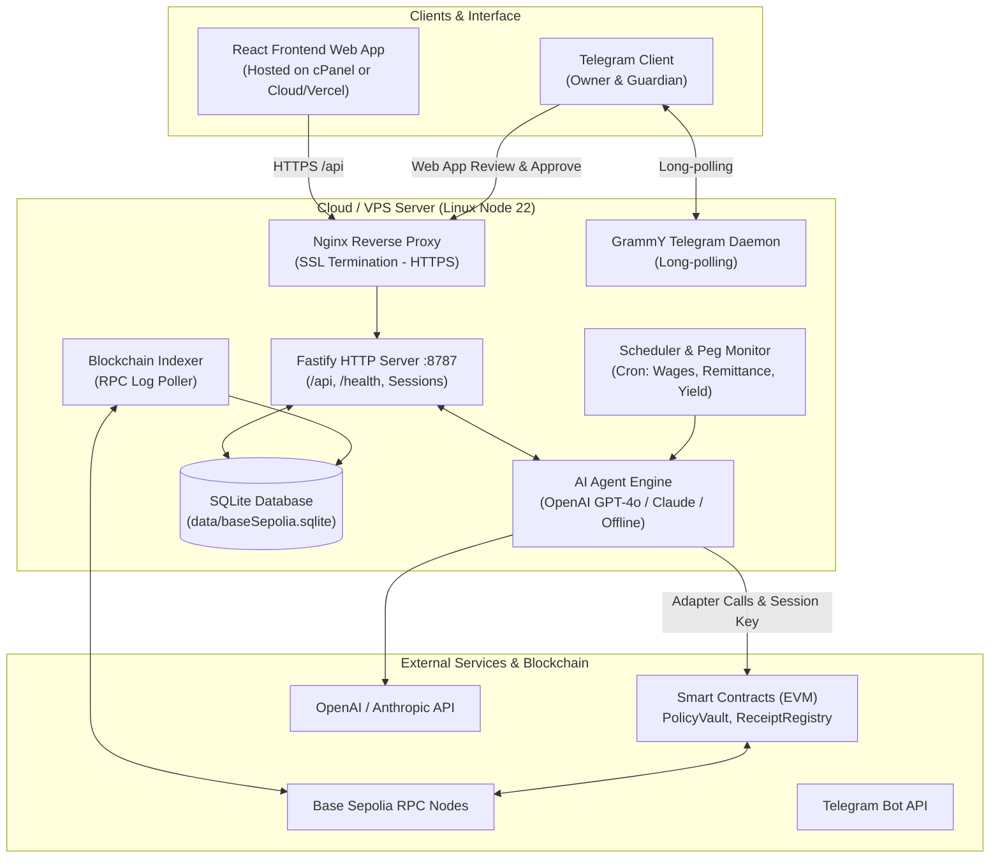
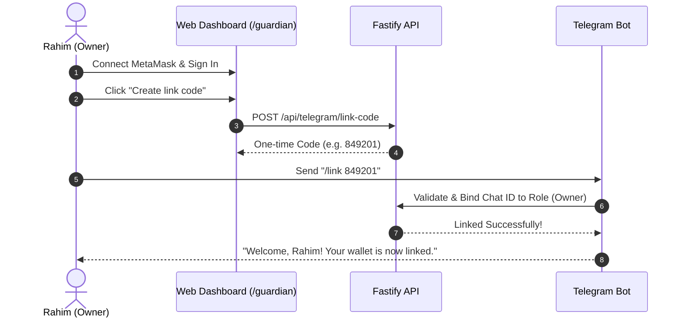

# Covenant: Production Deployment & Operations Guide
### Complete Runbook for Cloud (VPS/Docker), cPanel, Telegram Bot, and All Core Features

---

## Table of Contents
1. [Architecture & Production Topology](#1-architecture--production-topology)
2. [Prerequisites & Account Preparation](#2-prerequisites--account-preparation)
3. [Smart Contracts Deployment (Base Sepolia / EVM)](#3-smart-contracts-deployment-base-sepolia--evm)
4. [Cloud / VPS Deployment (Ubuntu / Docker / PM2)](#4-cloud--vps-deployment-ubuntu--docker--pm2)
   - 4.1 [Option A: Docker & Docker Compose (Recommended)](#41-option-a-docker--docker-compose-recommended)
   - 4.2 [Option B: Bare-Metal Ubuntu with PM2 & Systemd](#42-option-b-bare-metal-ubuntu-with-pm2--systemd)
   - 4.3 [Nginx Reverse Proxy & Let's Encrypt SSL Configuration](#43-nginx-reverse-proxy--lets-encrypt-ssl-configuration)
5. [cPanel Deployment Guide](#5-cpanel-deployment-guide)
   - 5.1 [Recommended Strategy: Frontend on cPanel + Backend on Cloud/VPS](#51-recommended-strategy-frontend-on-cpanel--backend-on-cloudvps)
   - 5.2 [Deploying React Frontend on cPanel (with .htaccess SPA Routing)](#52-deploying-react-frontend-on-cpanel-with-htaccess-spa-routing)
   - 5.3 [Deploying Node.js Backend on cPanel (Application Manager)](#53-deploying-nodejs-backend-on-cpanel-application-manager)
6. [Telegram Bot Integration (Full Setup)](#6-telegram-bot-integration-full-setup)
   - 6.1 [Bot Creation & Configuration](#61-bot-creation--configuration)
   - 6.2 [Account Linking Workflow](#62-account-linking-workflow)
   - 6.3 [Commands & Gasless Co-Signing Operations](#63-commands--gasless-co-signing-operations)
7. [Production Environment Reference (.env)](#7-production-environment-reference-env)
8. [Production Feature Guidelines & Operations](#8-production-feature-guidelines--operations)
   - 8.1 [Asset Management (Buckets, Lending & Peg Monitor)](#81-asset-management-buckets-lending--peg-monitor)
   - 8.2 [Remittance & Scheduled Unattended Mode](#82-remittance--scheduled-unattended-mode)
   - 8.3 [Gasless Approvals (EIP-712)](#83-gasless-approvals-eip-712)
   - 8.4 [Guardian Emergency Controls & Pause](#84-guardian-emergency-controls--pause)
   - 8.5 [Evidence Ledger & Verifiable Intent Receipts](#85-evidence-ledger--verifiable-intent-receipts)
9. [Maintenance, Monitoring & Troubleshooting](#9-maintenance-monitoring--troubleshooting)

---

## 1. Architecture & Production Topology

Covenant consists of four interconnected layers:



### Key Production Requirements:
- **HTTPS (SSL) is strictly required:** Telegram inline web app buttons and wallet signing sessions require valid SSL certificates (`https://`).
- **Persistent Daemon:** The backend process must run 24/7 because it contains the real-time blockchain event indexer, cron schedulers, and Telegram bot long-polling listener.
- **SQLite Storage:** Database file must be located on persistent disk storage (e.g. Docker volume or host directory).

---

## 2. Prerequisites & Account Preparation

### 2.1 Server Requirements
- **VPS / Cloud Instance:** Ubuntu 22.04 LTS or 24.04 LTS (1 vCPU, 2 GB RAM, 20 GB SSD minimum).
- **Node.js:** Version 22 LTS (`node -v` >= 22.0.0).
- **Package Manager:** `npm` (v10+).
- **Domain Name:** With DNS A-records pointing to your server IP (e.g., `covenant.yourdomain.com` or `api.yourdomain.com`).

### 2.2 Blockchain Wallets (Testnet / Base Sepolia)
You need 5 distinct Ethereum private keys (store securely in `.env`):
1. **Deployer:** Deploys contracts, funds test faucets, and sets up initial registries.
2. **Owner (Rahim):** Holds vault ownership, sets mandates, and signs co-signed payments (T2).
3. **Guardian (Mother):** Can pause the vault and revoke the agent; cannot spend.
4. **Agent Session Key:** Off-chain bot key that executes autonomous actions within PolicyVault limits.
5. **Employer:** Simulates automated monthly salary deposits.

> [!TIP]
> Fund the **Deployer**, **Owner**, and **Agent** wallets with at least 0.05 Base Sepolia ETH from public faucets (e.g., Superchain Faucet, QuickNode, or Alchemy Base Sepolia Faucet).

---

## 3. Smart Contracts Deployment (Base Sepolia / EVM)

Before launching the server, deploy the contracts and generate the contract addresses ledger.

### Step 1: Clone and Install
```bash
git clone https://github.com/feedofmri/Covenant.git
cd Covenant
npm install
```

### Step 2: Configure Deployment Keys
Copy `.env.example` to `.env`:
```bash
cp .env.example .env
```
Edit `.env` and set:
```env
DEPLOYMENT=baseSepolia
BASE_SEPOLIA_RPC_URL=https://sepolia.base.org
DEPLOYER_PRIVATE_KEY=0x...
OWNER_PRIVATE_KEY=0x...
AGENT_PRIVATE_KEY=0x...
GUARDIAN_PRIVATE_KEY=0x...
EMPLOYER_PRIVATE_KEY=0x...

# Payee addresses
GUARDIAN_ADDRESS=0x...
AGENT_ADDRESS=0x...
MOTHER_ADDRESS=0x...
SCHOOL_ADDRESS=0x...

# Basescan contract verification (optional)
ETHERSCAN_API_KEY=your_etherscan_or_basescan_api_key
```

### Step 3: Run Deployment Script
```bash
npm run deploy:base-sepolia
```

This script:
- Compiles Solidity contracts via Hardhat with `via-IR`.
- Deploys `VaultFactory`, `ReceiptRegistry`, `MockUSDC`, `MockEURC`, and mock Oracles.
- Creates Rahim's personal `PolicyVault` clone.
- Automatically verifies all contracts on [Basescan](https://sepolia.basescan.org).
- Writes addresses to `shared/deployments/baseSepolia.json` and mandate to `shared/mandates/baseSepolia.json`.

Commit the generated deployment files:
```bash
git add shared/deployments/baseSepolia.json shared/mandates/baseSepolia.json
git commit -m "chore: record Base Sepolia deployment"
```

---

## 4. Cloud / VPS Deployment (Ubuntu / Docker / PM2)

### 4.1 Option A: Docker & Docker Compose (Recommended)

Docker packages Node 22, dependencies, and anvil fork simulation in an isolated container.

#### 1. Prepare Docker Compose configuration
Check or update `docker-compose.yml`:
```yaml
version: "3.8"
services:
  covenant:
    build: .
    restart: always
    ports:
      - "8787:8787"
    environment:
      - NODE_ENV=production
      - DEPLOYMENT=baseSepolia
      - PORT=8787
      - HOST=0.0.0.0
      - DB_PATH=/data/baseSepolia.sqlite
      - UNATTENDED=1
    env_file:
      - .env
    volumes:
      - covenant_data:/data

volumes:
  covenant_data:
    driver: local
```

#### 2. Build and Start
```bash
docker compose up -d --build
```

#### 3. Verify Container Health
```bash
docker compose ps
docker compose logs -f covenant
curl http://127.0.0.1:8787/health
```

---

### 4.2 Option B: Bare-Metal Ubuntu with PM2 & Systemd

If running natively on Ubuntu/Debian:

#### 1. Install Node.js 22 LTS
```bash
curl -fsSL https://deb.nodesource.com/setup_22.x | sudo -E bash -
sudo apt-get install -y nodejs build-essential
sudo npm install -g pm2
```

#### 2. Setup Project Directory
```bash
mkdir -p /var/www/covenant
cd /var/www/covenant
git clone https://github.com/feedofmri/Covenant.git .
npm install
npm run build:contracts
```

#### 3. Create PM2 Ecosystem File (`ecosystem.config.cjs`)
Create `/var/www/covenant/ecosystem.config.cjs`:
```javascript
module.exports = {
  apps: [
    {
      name: "covenant-server",
      script: "server/src/index.js",
      cwd: "/var/www/covenant",
      instances: 1,
      autorestart: true,
      watch: false,
      max_memory_restart: "1G",
      env: {
        NODE_ENV: "production",
        DEPLOYMENT: "baseSepolia",
        PORT: 8787,
        HOST: "127.0.0.1",
        DB_PATH: "data/baseSepolia.sqlite",
        UNATTENDED: "1"
      }
    }
  ]
};
```

#### 4. Start with PM2 and Configure Boot Persistence
```bash
# Start server
pm2 start ecosystem.config.cjs

# Save PM2 state
pm2 save

# Enable auto-start on server reboot
pm2 startup
```

---

### 4.3 Nginx Reverse Proxy & Let's Encrypt SSL Configuration

Install Nginx and Certbot:
```bash
sudo apt-get update
sudo apt-get install -y nginx certbot python3-certbot-nginx
```

Create `/etc/nginx/sites-available/covenant`:
```nginx
server {
    server_name covenant.yourdomain.com;

    # Backend API and Health check
    location /api/ {
        proxy_pass http://127.0.0.1:8787;
        proxy_http_version 1.1;
        proxy_set_header Host $host;
        proxy_set_header X-Real-IP $remote_addr;
        proxy_set_header X-Forwarded-For $proxy_add_x_forwarded_for;
        proxy_set_header X-Forwarded-Proto $scheme;
    }

    location /health {
        proxy_pass http://127.0.0.1:8787/health;
        proxy_set_header Host $host;
    }

    # Frontend Static SPA Files (if serving from the same server)
    location / {
        root /var/www/covenant/web/dist;
        index index.html;
        try_files $uri $uri/ /index.html;
    }
}
```

Enable site and acquire SSL certificate:
```bash
sudo ln -s /etc/nginx/sites-available/covenant /etc/nginx/sites-enabled/
sudo nginx -t
sudo systemctl reload nginx

# Generate Let's Encrypt SSL Certificate
sudo certbot --nginx -d covenant.yourdomain.com
```

---

## 5. cPanel Deployment Guide

### 5.1 Recommended Strategy: Frontend on cPanel + Backend on Cloud/VPS

> [!IMPORTANT]
> **Why this strategy is best practice:**  
> cPanel shared hosting is optimized for static assets, PHP, and MySQL. However, Covenant's backend daemon needs **24/7 background execution** (blockchain event indexer, node-cron schedulers, and Telegram bot long-polling). Shared cPanel hosts frequently terminate long-running processes or block WebSocket/polling loops.  
> **Therefore, the most reliable setup is:**  
> 1. Host the React Frontend on **cPanel** (`https://covenant.yourdomain.com`).  
> 2. Host the Fastify API + Telegram Daemon on **Cloud / VPS** (`https://api.yourdomain.com`).

---

### 5.2 Deploying React Frontend on cPanel (with .htaccess SPA Routing)

#### Step 1: Build Frontend Locally
On your development machine or CI:
```bash
cd web
# Set the Cloud VPS backend API URL
VITE_API_URL=https://api.yourdomain.com npm run build
```
This creates static production assets in `web/dist/`.

#### Step 2: Create `.htaccess` for Single Page Application (SPA)
In `web/dist/`, create a `.htaccess` file so client-side routing (`/payees`, `/mandate`, `/approve/:id`, `/verify`) works without 404 errors:

```apache
<IfModule mod_rewrite.c>
  RewriteEngine On
  RewriteBase /
  RewriteRule ^index\.html$ - [L]
  RewriteCond %{REQUEST_FILENAME} !-f
  RewriteCond %{REQUEST_FILENAME} !-d
  RewriteCond %{REQUEST_FILENAME} !-l
  RewriteRule . /index.html [L]
</IfModule>

# Enable Browser Caching & Gzip Compression
<IfModule mod_expires.c>
  ExpiresActive On
  ExpiresByType image/svg+xml "access plus 1 month"
  ExpiresByType text/css "access plus 1 month"
  ExpiresByType application/javascript "access plus 1 month"
</IfModule>
```

#### Step 3: Upload to cPanel File Manager
1. Log in to your cPanel dashboard.
2. Open **File Manager** and navigate to `public_html/` (or your subdomain folder, e.g., `covenant/`).
3. Upload all contents from `web/dist/` (including `assets/`, `index.html`, and `.htaccess`).
4. Ensure **Force HTTPS Redirect** is enabled in cPanel under **Domains** > **Force HTTPS**.

---

### 5.3 Deploying Node.js Backend on cPanel (Application Manager)

If your cPanel hosting has **CloudLinux / "Setup Node.js App"** enabled:

1. In cPanel, search for **Setup Node.js App** and click **Create Application**.
2. **Node.js version:** Select **20.x** or **22.x**.
3. **Application mode:** Select **Production**.
4. **Application root:** `covenant-server`
5. **Application startup file:** `server/src/index.js`
6. Upload the backend code (`contracts/`, `shared/`, `agent/`, `server/`, `package.json`, `package-lock.json`) to `covenant-server/`.
7. Click **Run NPM Install** in cPanel.
8. Add Environment Variables in the cPanel UI under **Environment variables** (copy values from your `.env`).
9. Click **Start App**.

---

## 6. Telegram Bot Integration (Full Setup)

The Covenant Telegram bot provides natural-language mobile banking for the Owner and real-time oversight for the Guardian.

### 6.1 Bot Creation & Configuration

1. Open Telegram and search for `@BotFather`.
2. Send `/newbot`.
3. Choose a Name: `Covenant Agent Wallet`
4. Choose a Username: e.g., `CovenantFamilyBot` (must end with `bot`).
5. Copy the generated **HTTP API Token**.
6. Set in your server's `.env`:
   ```env
   TELEGRAM_BOT_TOKEN="1234567890:ABCdefGHIjklMNOpqrSTUvwxYZ"
   TELEGRAM_BOT_USERNAME="CovenantFamilyBot"
   WEB_URL="https://covenant.yourdomain.com"
   ```

> [!WARNING]
> `WEB_URL` **must begin with `https://`**. Telegram security policy disables inline Web App buttons if the URL is insecure (`http://`).

---

### 6.2 Account Linking Workflow

For security against unauthorized access, chats from unlinked Telegram accounts are silently ignored.



1. Open the Web Dashboard at `https://covenant.yourdomain.com`.
2. Connect your wallet as **Owner** or **Guardian** and sign in.
3. Navigate to the **Guardian** page (`/guardian`).
4. Under **Telegram link**, click **Create link code**.
5. Open your bot in Telegram and send:
   ```text
   /link <CODE>
   ```
6. The bot confirms your role and starts accepting instructions.

---

### 6.3 Commands & Gasless Co-Signing Operations

#### Available Commands:
- `/balance`: Displays total vault balance, unallocated funds, and yield earnings.
- `/buckets`: Shows the breakdown across **Family**, **Emergency**, and **Savings** buckets.
- `/limits`: Shows 24-hour sliding window usage and remaining limits.
- `/history`: Displays recent transactions with status and explorer links.
- `/proposals`: Shows pending Tier 2 escalation proposals.

#### Multilingual Natural Language Support:
The Owner can send free text in **English** or **Bangla**:
- `"send 200 to Mother"`
- `"মাকে ২০০ পাঠাও"`
- `"Mother needs 400 for hospital bill"`

#### Gasless Inline Approval (EIP-712):
When an action exceeds T1 autonomous limits (e.g., 400 USDC):
1. The agent compiles an on-chain **Proposal** on `PolicyVault`.
2. A Telegram notification arrives with a **"Review & approve"** button.
3. Tapping the button opens the secure web approval interface.
4. The Owner signs an **EIP-712 typed message** using their mobile browser wallet.
5. The server relays the signature on-chain (`approveWithSig`). **The owner pays zero gas!**

---

## 7. Production Environment Reference (.env)

Below is the complete `.env` reference for production deployment:

```env
# ── Deployment & Network ────────────────────────────────────────────────
DEPLOYMENT=baseSepolia
RPC_URLS=https://sepolia.base.org,https://base-sepolia-rpc.publicnode.com
BASE_SEPOLIA_RPC_URL=https://sepolia.base.org

# ── Etherscan / Basescan Verification ───────────────────────────────────
ETHERSCAN_API_KEY=your_etherscan_v2_key

# ── On-Chain Keys (Keep Private!) ───────────────────────────────────────
DEPLOYER_PRIVATE_KEY=0x...
OWNER_PRIVATE_KEY=0x...
AGENT_PRIVATE_KEY=0x...
GUARDIAN_PRIVATE_KEY=0x...
EMPLOYER_PRIVATE_KEY=0x...

# ── Registered Role Addresses ───────────────────────────────────────────
GUARDIAN_ADDRESS=0x...
AGENT_ADDRESS=0x...
MOTHER_ADDRESS=0x...
SCHOOL_ADDRESS=0x...
ATTACKER_ADDRESS=0x000000000000000000000000000000000000dEaD

# ── AI Model Configuration (Choose OpenAI or Claude) ────────────────────
MODEL_PROVIDER=openai                       # openai | chatgpt | anthropic | offline
OPENAI_API_KEY=sk-proj-...                 # Your ChatGPT / OpenAI API Key
OPENAI_BASE_URL=https://api.openai.com/v1   # Optional proxy/custom endpoint
PLANNER_MODEL=gpt-4o                        # Production Planner LLM
CLASSIFIER_MODEL=gpt-4o-mini                # Prompt-Injection Classifier
PLANNER_EFFORT=medium

# ── Server & Daemon Settings ────────────────────────────────────────────
PORT=8787
HOST=0.0.0.0
DB_PATH=data/baseSepolia.sqlite
ADMIN_TOKEN=your_super_secret_admin_token

# ── Web App & Telegram ──────────────────────────────────────────────────
WEB_URL=https://covenant.yourdomain.com
TELEGRAM_BOT_TOKEN=1234567890:ABCdef...
TELEGRAM_BOT_USERNAME=CovenantFamilyBot

# ── Autonomous Track Record & Cadence ────────────────────────────────────
UNATTENDED=1                                # 1 enables continuous automated cadence
UNATTENDED_WAGE=1000                        # Monthly wage simulation (USDC)
ANCHOR_MODE=each                            # each: anchor every receipt; batch: hourly Merkle root
```

---

## 8. Production Feature Guidelines & Operations

### 8.1 Asset Management (Buckets, Lending & Peg Monitor)

```
        ┌────────────────────────────────────────────────────────┐
        │                  INCOMING WAGES: $1,000                │
        └──────────────────────────┬─────────────────────────────┘
                                   │
         ┌─────────────────────────┼─────────────────────────┐
         ▼ 50%                     ▼ 20%                     ▼ 30%
┌─────────────────┐       ┌─────────────────┐       ┌─────────────────┐
│  FAMILY BUCKET  │       │ EMERGENCY FUND  │       │  SAVINGS BUCKET │
│     $500.00     │       │     $200.00     │       │     $300.00     │
└────────┬────────┘       └─────────────────┘       └────────┬────────┘
         │                                                   │
         ▼ Remittances ($200 to Mother)                      ▼ Lend Idle ($150 to Pool)
┌─────────────────┐                                 ┌─────────────────┐
│     MOTHER      │                                 │   AAVE YIELD    │
└─────────────────┘                                 └─────────────────┘
```

- **Bucket Splits:** Incoming wages are automatically divided per the owner's mandate:
  - **Family (50%):** Disbursed for household groceries, utility bills, and scheduled remittances.
  - **Emergency (20%):** Kept untouched unless medical or critical needs arise (owner must trigger reallocation).
  - **Savings (30%):** Kept with a $100 cash buffer; remaining idle funds are supplied to an Aave-style lending pool.
- **Oracle Peg Monitor:** Runs every hour. If USDC drops below 0.98 USD, yield is paused, all lent savings are withdrawn to the vault, and new lending reverts with `T3_Depegged`.

---

### 8.2 Remittance & Scheduled Unattended Mode
- **Unattended Mode (`UNATTENDED=1`):** Simulates real-world payroll and remittance schedules without human intervention to build an immutable on-chain track record.
- **Remittance Cron:** Triggers monthly transfers to registered family payees.

---

### 8.3 Gasless Approvals (EIP-712)
1. When an expense exceeds T1 limits (e.g. 400 USDC for medical bills), the agent records a Proposal in `PolicyVault`.
2. The proposal ID and details are served at `/approve/:id`.
3. The Owner clicks **"Approve with signature"**.
4. The frontend calls `walletClient.signTypedData(...)` conforming to EIP-712 domain:
   ```json
   {
     "name": "PolicyVault",
     "version": "1",
     "chainId": 84532,
     "verifyingContract": "0x..."
   }
   ```
5. Fastify relays the signature to `approveWithSig(proposalId, deadline, signature)`.
6. Transaction confirms on-chain without deducting gas from Rahim's wallet.

---

### 8.4 Guardian Emergency Controls & Pause
- **Instant Pause:** The Guardian (Mother) or Owner can open the Guardian page (`/guardian`) and click **"Pause agent"**.
- All agent calls immediately revert with `VaultPaused`.
- **Revoke Session Key:** The Guardian can click **"Revoke agent key"** to invalidate the current bot key.
- **Unpause:** Only the **Owner** can unpause the vault.

---

### 8.5 Evidence Ledger & Verifiable Intent Receipts
- **Evidence Ledger (`/ledger`):** Displays all executed transactions, gas used, tiers, and explorer links. Downloadable as CSV and Markdown.
- **Receipt Verification (`/verify`):** Paste any receipt JSON. The verifier recomputes:
  - `intentHash` (pre-trade checks & explanation)
  - `receiptHash` (execution deltas)  
  It checks these directly against `ReceiptRegistry.sol` on Base Sepolia.

---

## 9. Maintenance, Monitoring & Troubleshooting

### 9.1 Health Check
Run a curl against your public domain:
```bash
curl -s https://covenant.yourdomain.com/health | jq .
```
Expected output:
```json
{
  "ok": true,
  "chainId": 84532,
  "block": 18492042,
  "cursor": 18492040,
  "model": "openai",
  "unattended": true
}
```

### 9.2 Inspecting Logs
- **Docker:** `docker compose logs -f covenant`
- **PM2:** `pm2 logs covenant-server --lines 100`

### 9.3 Common Issues & Fixes

| Issue | Root Cause | Solution |
| :--- | :--- | :--- |
| **Telegram buttons not opening** | `WEB_URL` is not HTTPS or invalid domain | Ensure SSL is installed and `WEB_URL="https://covenant.yourdomain.com"` |
| **404 on page refresh on cPanel** | Missing SPA rewrite rules in `.htaccess` | Upload the `.htaccess` file described in [Section 5.2](#52-deploying-react-frontend-on-cpanel-with-htaccess-spa-routing) |
| **Agent reverts with `T3_DailyCapExceeded`** | Total payments in the 24-hour sliding window exceed limit | Wait for window slots to expire or propose as T2 co-signed payment |
| **Telegram bot doesn't reply** | Chat ID is not linked or another bot instance is polling | Run `/link <CODE>` from the Guardian page; ensure only one server instance is running |
| **Model API Error 429** | OpenAI / Anthropic rate limit reached | The agent automatically falls back to deterministic offline rules; check your OpenAI account billing |
| **Transaction simulation mismatch** | Slippage or balance delta divergence | Agent automatically pauses to protect funds; Owner must unpause after review |
